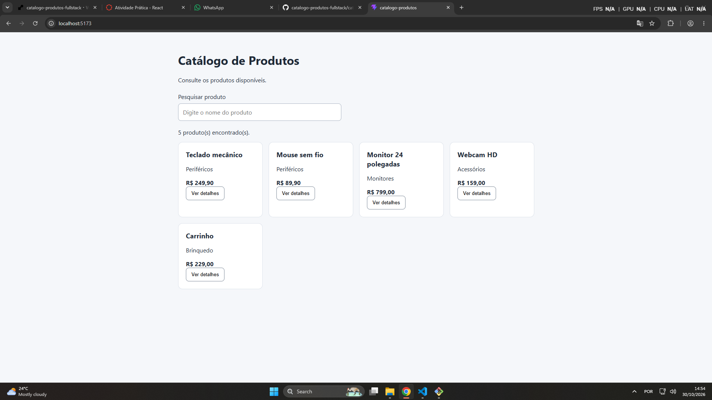
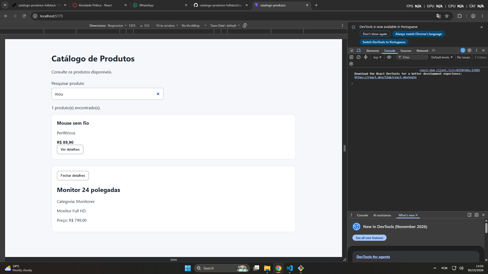
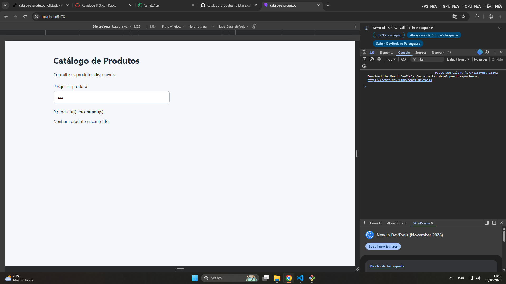

# Diagrama textual da árvore de componentes
```text
App (Componente Principal / Gerenciador de Estados)
├── Header (Cabeçalho estático)
├── ProductSearch (Campo de busca controlado)
├── ProductList (Grade/Listagem de produtos)
│   └── ProductCard (Cartão individual repetido via .map para cada produto)
└── ProductDetails (Painel condicional de detalhes exibido sob demanda)
```
# Explicação

"No meu código, o componente App é quem gerencia os estados principais, como a lista de produtos, o termo digitado na busca e o ID do item selecionado. Ao digitar no ProductSearch, ele atualiza o estado no App, que filtra os dados e manda pro ProductList desenhar os ProductCard na tela.

Ao clicar em 'Ver detalhes' nos cards, a aplicação pega o ID do respectivo produto e envia de volta pro App. Com o ID salvo, entra em ação o useEffect que consome a API REST usando o productsApi.js. Ele busca os dados, atualiza o estado e envia para o ProductDetails exibir as informações, tudo de forma fluida e sem precisar recarregar a página."

# Instruções de execução

## 1. Clonar o repositório
```bash
git clone <URL_DO_SEU_REPOSITORIO>
cd catalogo-produtos
```

## 2. Instalar dependência

# Instale as dependências
Na pasta raíz do projeto, execute: 
```bash
npm install
```

## 3. Configurar as Variáveis de Ambiente do Front-end
Crie um arquivo .env na raiz do projeto contendo o endereço da API:
VITE_API_URL=http://localhost:3000

## 4. Executar o frontend
Abrir um terminal na raiz do projeto e executar:
```bash
npm run dev
```

## 4. Executar o backend
Abrir um terminal na pasta ./backend e executar:
```bash
npm run server
```
# Evidências de sucesso



